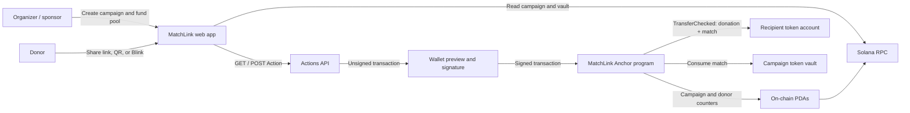

# MatchLink — donations that go further

> Share one Solana donation link. The donor's gift and the sponsor's match settle together in one on-chain transaction.

**[Quick Start](#quick-start)** · **[Architecture](#architecture)** · **[Demo Flow](#demo-flow)** · **[Roadmap](#roadmap)**

## Project Status

MatchLink is a devnet-focused hackathon MVP. The web experience, Actions API, and Anchor program source are in this repository. The program has not yet been compiled or deployed, and the end-to-end devnet flow has not yet been verified. Do not use real funds or mainnet.

## Problem and Solution

### Matching is hard to coordinate

Community donations and sponsor matches often arrive as separate transfers. Organizers have to reconcile them, track a sponsor pool, and explain the final totals.

### Donation links add friction

When a donor leaves a social feed to complete a contribution, some people abandon the flow. A regular link also does not show a transaction preview in Action-aware clients.

### MatchLink

An organizer creates a campaign, chooses a recipient and SPL token, sets matching limits, and funds the pool. Donors open the share link or QR code and sign a transaction. The MatchLink program transfers the donation and the available match to the recipient atomically.

## Why Solana

- **Atomic settlement** — the donor transfer and sponsor match run in one instruction. If an instruction fails, the transaction's state changes roll back.
- **On-chain pool** — sponsor funds and campaign counters are visible on Solana.
- **Low-cost transfers** — supports small test-token donations without a custodial payment processor.
- **Actions and Blinks** — an Actions endpoint can return a transaction for compatible wallets and clients; the web campaign remains the fallback.

## Summary of Features

- Campaign creation and initial pool funding in one wallet transaction.
- One SPL token mint per campaign.
- Configurable match rate, per-donation cap, and per-wallet cap.
- Match is also limited by the remaining vault balance.
- Basic self-donation guard: donor and recipient cannot be the same wallet.
- Sponsor can close an expired campaign and reclaim the remaining pool.
- Public campaign state, shareable link, QR code, and browser fallback.
- Solana Actions `GET`, `POST`, and `OPTIONS` endpoints with CORS support.

The per-wallet cap limits repeated matching for one wallet; it does not prevent Sybil wallets or coordinated abuse. Matching is calculated in token units, not USD.

## Tech Stack

| Layer | Technology |
| --- | --- |
| On-chain program | Rust · Anchor · Solana SPL Token Program |
| Web app and client | TypeScript · React · Next.js · `@solana/web3.js` |
| Transaction links | Solana Actions / Blinks-compatible API |
| QR code | `qrcode` |
| Network for MVP | Solana devnet · test SPL tokens |

## Architecture



The program owns campaign rules and the sponsor vault. The server builds an unsigned transaction; it does not hold donor or sponsor keys. Campaign title, description, and display goal are presentation metadata supplied in the public page URL, not on-chain fields.

## Quick Start

### Requirements

- Node.js 20+ and npm
- Phantom browser wallet for the current web transaction flow
- Rust, Solana CLI, and Anchor CLI to build and deploy the program
- A devnet wallet with test SOL and a test SPL token balance

### Run the web app

```powershell
npm install
Copy-Item .env.example .env.local
npm run dev
```

Open `http://localhost:3000`. The root page is a preview until a deployed program and campaign are configured. Campaign setup is at `http://localhost:3000/create`.

Set these values in `.env.local` after deploying the Anchor program:

```dotenv
NEXT_PUBLIC_SOLANA_CLUSTER=devnet
NEXT_PUBLIC_PROGRAM_ID=<deployed-program-id>
NEXT_PUBLIC_CAMPAIGN_ADDRESS=
SOLANA_RPC_URL=https://api.devnet.solana.com
```

For Vercel setup, environment scopes, and the devnet deployment checklist, see [DEPLOY_VERCEL.md](DEPLOY_VERCEL.md).

### Build and deploy on devnet

Use a test wallet only. `Anchor.toml` contains a placeholder program ID; generate the program keypair and synchronize the ID before deployment:

```powershell
anchor build
anchor keys sync
anchor build
solana config set --url devnet
anchor deploy
```

Copy the generated program ID into `.env.local` as `NEXT_PUBLIC_PROGRAM_ID`, restart the web app, and create a devnet SPL mint and test-token balances before using `/create`.

## Demo Flow

1. Connect the sponsor wallet and open `/create`.
2. Set the recipient, devnet mint, 1:1 matching, per-donation and per-wallet limits, pool size, and expiry.
3. Sign once to create the campaign and fund its vault.
4. Share the campaign page, Actions link, or QR code.
5. From a separate donor wallet, contribute 5 tokens. With a 1:1 rate, sufficient pool balance, and caps that allow it, the recipient should receive 10 tokens while the pool decreases by 5.
6. Verify the transaction, campaign account, and vault on Solana Explorer.

## Roadmap

- [x] Campaign and donor account model; matching program source.
- [x] Sponsor setup, donor page, Actions API, QR, and on-chain read paths.
- [x] Per-donation and per-wallet match limits; post-expiry pool return path.
- [ ] Compile and review the Anchor program.
- [ ] Deploy to devnet and verify the complete 5 → 10 token demo.
- [ ] Test the Action with a public HTTPS URL and compatible wallet/client.
- [ ] Complete a security review before any production use.

See [PLAN.md](PLAN.md) for the full implementation stages and current verification notes.

## Repository Map

- `programs/matchlink/src/lib.rs` — Anchor program.
- `app/` — Next.js pages and Actions endpoints.
- `lib/solana.ts` — account parsing, PDA/ATA helpers, and transaction builders.
- `PLAN.md` — approved product and development plan.

## Resources

- [Solana Actions and Blinks](https://solana.com/docs/advanced/actions)
- [Anchor token accounts](https://www.anchor-lang.com/docs/tokens/basics/create-token-account)
- [Anchor token transfers](https://www.anchor-lang.com/docs/tokens/basics/transfer-tokens)
- [Example README structure](https://github.com/Marakaya/colosseum_example)

## License

No license has been added yet. Until a `LICENSE` file is included, reuse and redistribution permissions are not specified.
